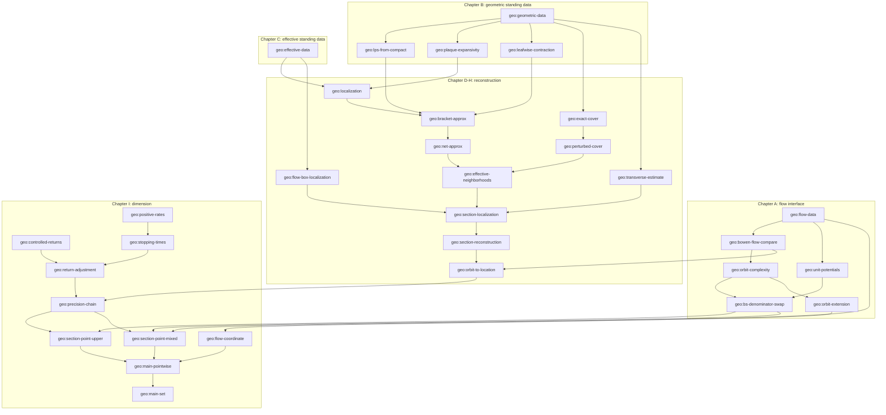

# Blueprint: pointwise upper bound under controlled regular returns

Geodesic flow on a closed rank-one surface of nonpositive curvature.
Target: the two inequalities of `thm:upperbounds` (main.tex / WIP_middle.tex), in Barreira–Schmeling (BS) form, for points with controlled regular returns and positive lower exponents.

The point-to-set framework is **not** re-proved. It is cited from the Lean formalization
<https://github.com/AlexeyMilovanov/kolmogorov-complexity-lean> (`KolmogorovMathlib/PointToSet/`, namespace `Kolmogorov.PointToSet`), whose declarations are named exactly below. Section 1 lists everything imported from it.

Sources (all paths relative to the uploaded archive):

| short name | file |
|---|---|
| OTL | `orbit-to-location-lemmas.tex` (cleanest version of the reconstruction chain) |
| MAIN | `main.tex` (statements, geodesic preliminaries, first drafts of the same lemmas) |
| WIP | `WIP_middle.tex` (same as MAIN §§ with the controlled-return definition) |
| PO | `paper-outline.tex` (annotated plan; §4.2 is the proof architecture followed in Chapter I) |
| UEL | `unstable_expansivity_lemma.tex` (flat strip, plaque expansivity, refined localization lemma) |
| LBF | `Lower_bound_future_paper.tex` §"Adding the flow direction" (flow-coordinate lemmas) |
| BSN | `Things I am copying from/bs_dimension_working_notes.tex` (uniform-model template, gap list) |
| MP | `middle_part.tex` (computability conventions, `lem:intersection_computable_point`) |

Status tags used on every node:

* **[imported]** exists in the Lean repository; cite, do not prove.
* **[axiom]** a geometric fact about geodesic flows that Mathlib cannot currently express or prove; to be a field of a standing-data structure, with the classical reference recorded.
* **[drafted]** a complete informal proof exists in the drafts and is transcribed here.
* **[sketch]** the drafts only sketch it; the sketch is transcribed and the missing steps are named.
* **[new]** not written in any draft; the argument is assembled here from the plan in PO §4.2 and must be checked.

Marks: **✎** the statement here differs from the drafts (hypothesis, indexing or convention changed); **⚠** a known error or gap in the drafts.

---

## 0. Conventions and design decisions

These decisions are forced by the shape of the Lean library and should be fixed before any node is formalized.

**D1. Discrete time.** The library works with a continuous map `T : X → X`, Bowen balls `bowenBall T n x ε = {y | ∀ k < n, dist (T^[k] x) (T^[k] y) < ε}` and Birkhoff sums `birkhoffSum T u n x = ∑_{k<n} u (T^[k] x)`. There is no flow support. So the flow `φ : ℝ → X → X` enters only through its time-one map `f := φ 1` and `f⁻¹ := φ (-1)`, with unit-time integrated potentials (node `geo:unit-potentials`). Continuous orbit control on `[0, n]` follows from the discrete Bowen ball of order `n + 1` and the Lipschitz constant of `φ` on `|s| ≤ 1` (node `geo:bowen-flow-compare`). This is the "sampled flow with integrated unit-time potentials" option of PO §2.3.

**D2. Bits.** The library uses `Real.logb 2`, dyadic radii `dyadicRadius p = 2⁻ᵖ`, and weights `2^(-s·S)`. All natural-exponential estimates of the drafts (`e^{-∫λ}`) are converted by defining the potentials in bits: `u⁺(x) = (ln 2)⁻¹ ∫₀¹ λᵘ(φ τ x) dτ`. Then `e^{-∫₀ⁿ λᵘ} = 2^{-S_n u⁺}` exactly. Complexity, entropy and expansion are converted together, as PO §2.3 requires.

**D3. Static and dynamic pointwise quantities.** `dim^A(x), Dim^A(x)` are `(staticPointDimensions P A x).1, .2` (liminf/limsup over `𝓝[>] 0` of `K^A_δ(x) / (−log₂ δ)`, with `K^A_δ(x) = precisionComplexity P A x δ` the minimum of `oracleNatComplexity A i` over ideal `i` with `dist (P.ι i) x < δ`). `dim^A_BS(x,T,u), Dim^A_BS(x,T,u)` are `(pointwiseBSDimension P T u A x).1, .2`: `⨆ p, liminf/limsup_n finiteScaleBSCost P T u A x n (dyadicRadius p)`, and `finiteScaleBSCost` is the minimum over ideal `i ∈ bowenBall T n x ε` with `0 < S_n u (ι i)` of `K^A(i) / S_n u (ι i)`. Note the denominator is evaluated **at the ideal point**, not at `x`; node `geo:bs-denominator-swap` bridges this (the "small-distortion comparison" PO §2.3 asks for).

**D4. Oracles.** An oracle is `A : Set ℕ`; `A ≤_T B` is `charOracle A ≤ᵀ charOracle B`. The structural theorem is stated for every `A` above a base oracle `B` that computes the fixed presentation and the geometric data (`IsAdmissible`-style hypotheses, node `geo:effective-data`). Transfer to sets uses the cone versions `classicalPointToSet_cone_upper` and `bsPointToSet_cone`.

**D5. Geometry as a structure.** Mathlib has no geodesic flows, Jacobi fields, horospheres or invariant foliations. Chapter B lists the geometric facts actually used by the proofs as fields of one structure `GeodesicReconstructionData`, each with its classical reference. Chapter B is the "precise hypothesis list" PO §3.2 asks for. Verifying these fields for nonpositive curvature is a separate (non-Lean, or future) task.

**D6. Integer return times ✎.** Controlled regular returns are defined with `T⁺, T⁻ ∈ ℕ`. This is equivalent to the real-time definition of the drafts after replacing `P^±` by `φ([−1,0]) P^±`, which is still compact and still disjoint from `Sing` (invariance). Record this as a remark, not a lemma.

**D7. Localization constants may depend on `x`.** Constants `ε, C, κ, L, …` depend on `x`, `ρ`, `c` and the chosen flow box but never on the durations `T^±` or the precision `p`. This is what makes the final `limsup` arguments work (PO §4.2 "Local constants and thresholds may depend on `x` but must not grow with precision").

---

## 1. Imported from `kolmogorov-complexity-lean` **[imported]**

All in namespace `Kolmogorov.PointToSet`; paths under `KolmogorovMathlib/`.

| what | declaration | file |
|---|---|---|
| presentation (dense ideal sequence `ι`, complete) | `Presentation X`, `dyadicRadius`, `IsCauchyName`, `basicBall` | `PointToSet/ComputableMetric/Presentation.lean` |
| computable metric table, represented maps, admissible oracles | `ComputablePresentationIn`, `IsRepresentedMapIn`, `IsAdmissible`, `realPresentation` | same |
| relative c.e. predicates, enumerations, closure toolkit | `IsREIn`, `IsEnumerationIn`, `relative_closure_*` | `Oracle/Basic.lean` |
| oracle prefix complexity | `oracleNatComplexity A i`, `oraclePairComplexity`, `oracleComplexity` | `Oracle/PrefixComplexity/Basic.lean` |
| pair overhead `K(i,n) ≤ K(i) + 2log₂(n+1) + c` | `oracle_tuple_bounds_overhead` | same |
| composition `K(F xs) ≤ ∑ K(x_j) + c` for `A`-partial-recursive `F` | `oracle_tuple_bounds_composition` | same |
| oracle monotonicity `K^B ≤ K^A + c` for `A ≤_T B` | `oracle_monotonicity` | same |
| joins | `oracleJoin`, `oracle_joins`, `oracle_joins_right`, `oracleCountableJoin` | `Oracle/Joins.lean` |
| precision complexity and static dimensions | `precisionComplexity`, `precisionComplexityNat`, `normalizedPrecisionComplexity`, `staticPointDimensions`, `staticPointDimensions_attained`, `_antitone` | `PointToSet/ComputableMetric/StaticDimensions.lean` |
| dimension along a scale sequence (`log δ_{m+1}/log δ_m → 1`) | `dimension_along_scales`, `dimension_along_scales_upper` | `PointToSet/ComputableMetric/DimensionAlongScales.lean` |
| admissible base oracle exists | `exists_admissible_base` | `PointToSet/ComputableMetric/StaticDimensions.lean` |
| Bowen balls, Bowen distance, openness, ideal points inside | `bowenBall`, `bowenDist`, `mem_bowenBall_iff`, `bowen_ball_dense*`, `bowenBall_subset_of_le` | `PointToSet/Dynamics/BowenBalls.lean`, `BirkhoffComputability.lean` |
| semidecidable strict comparisons of Birkhoff values and orbit distances | `birkhoff_computableIn`, `birkhoff_computableIn_lt`, `_gt`, `_dist` | same |
| oscillation moduli and `|S_n v(y) − S_n v(x)| ≤ nω_p` on Bowen balls | `small_scale_oscillation`, `small_scale_oscillation_birkhoff` | `PointToSet/Dynamics/BowenBalls.lean` |
| finite-scale BS cost, pointwise BS dimension, lower Birkhoff average | `finiteScaleBSCost`, `pointwiseBSDimension`, `lowerBirkhoffAverage`, `upperBirkhoffAverage` |
| finite orbit complexity `K^A_n(x,T,ε)` | `orbitComplexity` (`ℕ∞`), `orbitComplexityNat` | `PointToSet/Pressure/Defs.lean` | `PointToSet/Dynamics/BowenBalls.lean`, `PointwiseQuantities.lean`, `BSDimension/Defs.lean` |
| attainment of the finite-scale minimum | `finite_scale_min_attained`, `finite_scale_min_attained_ratio`, `finiteScaleBSCost_le_div` | `PointToSet/Dynamics/BowenBalls.lean` |
| additive slack vanishes after normalization; oracle monotonicity of BS dimensions | `normalized_additive_slack`, `normalized_additive_slack_bs`, `_bs_upper`, `bsPointToSet_mono_oracle` | `PointToSet/Order/NormalizedSlack.lean`, `BSDimension/Upper/OracleAttainment.lean` |
| lower/upper selector | `LimitSide`, `LimitSide.choose`, `LimitSide.timeLimit` | `PointToSet/BSDimension/Defs.lean` |
| classical BS dimensions of a set | `lowerBSDimension T u Z`, `upperBSDimension T u Z` | `PointToSet/BSDimension/Defs.lean` |
| **Main B** (BS point-to-set, one cone for both sides) | `bsPointToSet`, `bsPointToSet_upper`, `bsPointToSet_cone` | `PointToSet/BSDimension/Upper/PointToSetPrinciple.lean` |
| classical Hausdorff/packing point-to-set, restrictable to a cone | `classicalPointToSet`, `classicalPointToSet_upper`, `classicalPointToSet_cone`, `classicalPointToSet_cone_upper`, `classicalPointToSet_attained`, `metricPackingDimension` | `PointToSet/Conformal/Classical/PointToSetPrinciple.lean`, `Conformal/Defs.lean` |
| attained oracle minima on cones | `exists_achieving_oracle*` | `PointToSet/Order/AchievingOracles.lean` |
| one-sided conformal analog of the whole argument (template only) | `UniformConformalData`, `pointwiseDimensionEqBS`, `pointwiseDimensionEqBS_upper` | `PointToSet/Conformal/Defs.lean`, `Conformal/Distortion/PointwiseDimension.lean` |

Exact statements that the final step relies on:

```lean
theorem bsPointToSet_cone (P : Presentation X) (T : X → X) (hT : Continuous T)
    (u : X → ℝ) (hu : UniformContinuous u) (Z : Set X)
    (hZ : ∀ x ∈ Z, 0 < lowerBirkhoffAverage T u x) :
    ∃ A₀ : Set ℕ, ∀ A : Set ℕ, charOracle A₀ ≤ᵀ charOracle A →
      IsAdmissible P T (fun _ : Fin 1 => u) A ∧ ∀ σ : LimitSide,
        σ.choose (lowerBSDimension T u Z, upperBSDimension T u Z) =
          ⨆ x ∈ Z, σ.choose (pointwiseBSDimension P T u A x)

theorem classicalPointToSet_cone_upper (P : Presentation X) (Z : Set X) (A₀ : Set ℕ) :
    metricPackingDimension Z = ⨅ A : Set ℕ, ⨅ (_ : charOracle A₀ ≤ᵀ charOracle A),
      ⨆ x ∈ Z, (staticPointDimensions P A x).2

theorem dimension_along_scales_upper (P : Presentation X) (A : Set ℕ) (x : X)
    (δ : ℕ → ℝ) (hpos : ∀ m, 0 < δ m) (hzero : Tendsto δ atTop (𝓝 0))
    (hratio : Tendsto (fun m => Real.log (δ (m + 1)) / Real.log (δ m)) atTop (𝓝 1)) :
    (staticPointDimensions P A x).2 =
      limsup (fun m => normalizedPrecisionComplexity P A x (δ m)) atTop

theorem small_scale_oscillation_birkhoff (T : X → X) (v : X → ℝ) (p : ℕ) (ω : ℝ)
    (hω : ∀ x y, dist x y < 2 * dyadicRadius p → |v x - v y| ≤ ω) (x : X) (n : ℕ)
    (y : X) (hy : y ∈ bowenBall T n x (dyadicRadius p)) :
    |birkhoffSum T v n y - birkhoffSum T v n x| ≤ n * ω
```

---

## 2. Dependency graph



Suggested build order (each item depends only on earlier ones): A → B (as a structure, no proofs) → C → `geo:localization` → `geo:bracket-approx` → `geo:net-approx` → F → G → `geo:orbit-to-location` → I. The flow-coordinate node and the Chapter A nodes are independent of the geometry and can be done first as warm-ups.

---

## 3. Chapter A: flow-to-map interface

### `geo:flow-data` — Standing analytic data **[new]**

**Statement.** `X` is a compact metric space (`T¹M` with the Knieper metric `d_K`, or Sasaki; the two are bi-Lipschitz on `T¹M`, see OTL §1) with a fixed presentation `P : Presentation X`. `φ : Flow ℝ X` is a continuous flow (Mathlib `Flow`), and there is `L ≥ 1` with `dist (φ s x) (φ s y) ≤ L · dist x y` for all `|s| ≤ 1`. Write `f := φ 1`, `f⁻¹ := φ (−1)`, so `f^[n] = φ n` and `(f⁻¹)^[n] = φ (−n)`.

**Lean sketch.**
```lean
structure FlowData (X : Type*) [MetricSpace X] [CompactSpace X] where
  φ : Flow ℝ X
  L : ℝ
  one_le_L : 1 ≤ L
  lipschitz_unit : ∀ s : ℝ, |s| ≤ 1 → ∀ x y, dist (φ s x) (φ s y) ≤ L * dist x y
  V : ℝ
  speed_unit : ∀ s : ℝ, |s| ≤ 1 → ∀ y, dist (φ s y) y ≤ V * |s|

def FlowData.f (D : FlowData X) : X → X := D.φ 1
def FlowData.finv (D : FlowData X) : X → X := D.φ (-1)
lemma FlowData.iterate_f (D : FlowData X) (n : ℕ) : D.f^[n] = D.φ n
```

**Proof.** `f^[n] = φ n` by induction from `φ.map_add`. Lipschitz on `|s| ≤ 1` and the speed bound `V` (used only in `geo:flow-coordinate`; `V = 1` for the unit-speed geodesic flow in the Sasaki metric) are hypotheses, true for a `C¹` flow on a compact manifold.

### `geo:bowen-flow-compare` — Discrete Bowen balls control continuous orbits **[new]**

**Statement.** If `y ∈ bowenBall f (n+1) x ε` then `dist (φ t x) (φ t y) < L ε` for every real `t ∈ [0, n]`. Conversely `{y | ∀ t ∈ [0,n], dist (φ t x) (φ t y) < ε} ⊆ bowenBall f (n+1) x ε`. Same for `f⁻¹` and `t ∈ [−n, 0]`.

**Uses.** `geo:flow-data`.

**Proof.** Write `t = k + s` with `k = ⌊t⌋ ≤ n`, `s ∈ [0,1)`. Then `dist (φ t x) (φ t y) = dist (φ s (φ k x)) (φ s (φ k y)) ≤ L · dist (f^[k] x) (f^[k] y) < L ε`. The converse is immediate since integers are in `[0,n]`.

**Remark.** This is what makes "an orbit description at tolerance `ε` on `[0,T]`" (OTL §1, "Effective hypotheses") equal to an ideal point of `bowenBall f (T+1) x ε`: from the ideal index `i` and the represented flow one computes `φ t (ι i)` for rational `t`, with error `< L ε` against `φ t x`. All later tolerances `ε(ρ)` are to be divided by `L`.

### `geo:unit-potentials` — Unit-time integrated rates **[new]**

**Statement.** Given continuous `λᵘ, λˢ : X → ℝ` with `0 ≤ λ ≤ Λ` (Chapter B), define
`u⁺ x := (Real.log 2)⁻¹ ∫ τ in (0:ℝ)..1, λᵘ (φ τ x)` and `u⁻ x := (Real.log 2)⁻¹ ∫ τ in (0:ℝ)..1, λˢ (φ (−τ) x)`.
Then (i) `u^±` are continuous, hence uniformly continuous (compactness), with `0 ≤ u^± ≤ Λ / ln 2`; (ii) `birkhoffSum f u⁺ n x = (ln 2)⁻¹ ∫₀ⁿ λᵘ(φ τ x) dτ =: S_u(n,x)/ln 2` and `birkhoffSum f⁻¹ u⁻ n x = (ln 2)⁻¹ ∫₀ⁿ λˢ(φ(−τ) x) dτ =: S_s(n,x)/ln 2`; (iii) `0 < lowerBirkhoffAverage f u⁺ x ↔ liminf_{t→∞} S_u(t,x)/t > 0`, and the same backward.

**Uses.** `geo:flow-data`.

**Proof.** (i) continuity of parametric integrals of a continuous integrand on a compact domain. (ii) `∫₀ⁿ = ∑_{k<n} ∫_k^{k+1}` and `∫_k^{k+1} λ(φ τ x) dτ = ∫₀¹ λ(φ τ (φ k x)) dτ = (ln 2) u⁺(f^[k] x)` by the flow property and translation of the integral. (iii) for `t ∈ [n, n+1]`, `|S_u(t,x) − S_u(n,x)| ≤ Λ`, so the two lower limits agree.

**Remark.** From here on, "`S_u(T,x)`" in the drafts is read as `(ln 2) · birkhoffSum f u⁺ T x`, and `e^{−(S_u(T,x) − ρT)}` as `2^{−(birkhoffSum f u⁺ T x − ρ' T)}` with `ρ' = ρ/ln 2`. I write `S_T u⁺(x)` for `birkhoffSum f u⁺ T x`.

### `geo:orbit-complexity` — Finite orbit complexity **[imported]** (definition exists; properties new)

**Statement.** `orbitComplexity P T A x n ε : ℕ` is the minimum of `oracleNatComplexity A i` over ideal `i` with `P.ι i ∈ bowenBall T n x ε`, for `n ≥ 1`, `ε > 0` (nonempty by `bowen_ball_dense`, attained since `ℕ` is well ordered). It is nondecreasing in `n` (`bowen_ball_dense_succ`) and nonincreasing in `ε` (`bowenBall_subset_of_le`). This is `K^A_n(x,T,ε)` of the drafts (MP §"Orbit complexity", here with `n` observation times `0,…,n−1`).

**Lean.** Already in the library: `orbitComplexity P T A x n ε : ℕ∞` (an `ENat` infimum) and its natural shadow `orbitComplexityNat` in `PointToSet/Pressure/Defs.lean` (blueprint node `pressure:entropy-definitions`). Use `orbitComplexityNat`; only the monotonicity, attainment, order-shift and oracle-monotonicity lemmas are new.

**Relation to the library.** `finiteScaleBSCost P T u A x n ε ≤ orbitComplexity … / S_n u (ι i*)` for the minimizer `i*` provided `0 < S_n u (ι i*)` (`finiteScaleBSCost_le_div`). The reverse comparison is `geo:bs-denominator-swap`.

### `geo:bs-denominator-swap` — Center versus ideal-point denominators **[new]** (PO §2.3 "small-distortion comparison")

**Statement.** Let `u` be uniformly continuous with oscillation moduli `ω_p → 0` as in `small_scale_oscillation`, and suppose `0 < lowerBirkhoffAverage T u x`, so there are `λ̲ > 0`, `N₀` with `S_n u(x) ≥ λ̲ n` for `n ≥ N₀`. Then for every `p ≥ p₀` and `σ : LimitSide`,
```
σ.timeLimit (fun n ↦ orbitComplexity P T A x n (dyadicRadius p) / S_n u(x))
  ≤ (1 + 2 ω_p / λ̲) · σ.timeLimit (fun n ↦ finiteScaleBSCost P T u A x n (dyadicRadius p))
  ≤ (1 + 2 ω_p / λ̲) · σ.choose (pointwiseBSDimension P T u A x)
```
and the left side is nondecreasing in `p`. Consequently `sup_p` (equivalently `lim_p`) of the left side is `≤ σ.choose (pointwiseBSDimension P T u A x)`.

**Uses.** `geo:orbit-complexity`, imported `small_scale_oscillation_birkhoff`, `finite_scale_min_attained_ratio`.

**Proof.** For `n ≥ 2N₀` and `i ∈ bowenBall T n x (dyadicRadius p)` with `p ≥ p₀`: `|S_n u(ι i) − S_n u(x)| ≤ n ω_p` (`small_scale_oscillation_birkhoff`, radius `dyadicRadius p < 2·dyadicRadius p`). If also `ω_p ≤ λ̲/2` then `S_n u(ι i) ≥ nλ̲/2 > 0` and
`K(i)/S_n u(x) = (K(i)/S_n u(ι i)) · (S_n u(ι i)/S_n u(x)) ≤ (K(i)/S_n u(ι i)) · (1 + nω_p/(nλ̲)) `. Take `i` minimizing `K(i)/S_n u(ι i)` (`finite_scale_min_attained_ratio`; denominators are bounded between `nλ̲/2` and `nΛ`), then minimize over `i` on the left. Pass to `liminf`/`limsup` in `n`; the constant factor commutes with both. The last inequality is `le_iSup` at index `p`. Monotonicity in `p`: smaller radius, larger minimum.

### `geo:orbit-extension` — Extending an orbit description by crude itinerary data **[new]** (needed only for the mixed Hausdorff bound)

**Statement.** Let `T` be continuous and `A` admissible for `(P, T)`. For every `ε > 0` there is `N = N(ε) ∈ ℕ` and `c` such that for all `y`, `n ≥ 1`, `m`:
`orbitComplexity P T A y (n+m) (2ε) ≤ orbitComplexity P T A y n ε + m · ⌈log₂ N⌉ + 2 log₂(n+1) + 2 log₂(m+1) + c`.

**Uses.** `geo:orbit-complexity`, imported `birkhoff_computableIn_lt` (semidecidability of `ι j ∈` an open Bowen-type set), `oracle_tuple_bounds_overhead`, `oracle_tuple_bounds_composition`.

**Proof.** Fix a finite `ε/2`-net of ideal points `c_1,…,c_N` (compactness; its index list is a constant of the program). Let `i` realize `orbitComplexity P T A y n ε`, and let `j_n,…,j_{n+m−1} ∈ {1..N}` be such that `T^[k] y ∈ B(c_{j_k}, ε/2)`. The set
`O := bowenBall T n (ι i) ε ∩ ⋂_{k=n}^{n+m−1} T^[k]⁻¹ B(c_{j_k}, ε/2)`
is open (continuity of `T`) and contains `y`, hence contains an ideal point `ι l`, and membership of an ideal point in `O` is `A`-semidecidable (finite conjunction of strict rational inequalities on computable reals). A fixed `A`-partial-recursive search on input `(i, n, m, j_n…j_{n+m−1})` outputs the first such `l`. For `k < n`: `dist (T^[k] ι l) (T^[k] y) < 2ε` by the triangle inequality through `ι i`; for `n ≤ k < n+m`: `< ε/2 + ε/2`. So `ι l ∈ bowenBall T (n+m) y (2ε)`. Description length: `K(i) + m⌈log₂ N⌉ + K(n,m)-overheads + c` via `oracle_tuple_bounds_composition` and `oracle_tuple_bounds_overhead`.

---

## 4. Chapter B: geometric standing data **[axiom]** unless marked

One structure, `GeodesicReconstructionData X`, extending `FlowData X`. Each field is a classical fact about geodesic flows on closed rank-one surfaces of nonpositive curvature; the reference is recorded so the structure can later be instantiated outside Lean or in a future Mathlib. Where the drafts prove a field from more primitive facts (Jacobi fields), the draft proof is transcribed as justification, but the proposal is to take the *consequence* as the field.

### `geo:geometric-data` — The structure

Fields (notation: `Reg := Singᶜ`; `W^*_r(x)` the radius-`r` ball in the leaf metric `d^*`; `*` ranges over `u, s, cu, cs`):

* **(G1) singular set.** `Sing : Set X` closed, `φ`-invariant. *[Eberlein; Ballmann. Sing is the set of vectors whose geodesic sees only zero curvature.]*
* **(G2) rates.** `λᵘ λˢ : X → ℝ` continuous, `0 ≤ λ ≤ Λ`, and `λᵘ x = 0 ∧ λˢ x = 0 ↔ x ∈ Sing`. Only "`λᵘ x > 0 → x ∈ Reg`" is used. *[Burns–Gelfert 2013 / BCFT 2018 §2: defined from the unstable/stable Riccati solutions; nonnegativity because nonpositive curvature.]*
* **(G3) leaves and leaf metrics.** For each `* ∈ {u,s,cu,cs}` a map `x ↦ W^*(x) ⊆ X` with `φ t (W^*(x)) = W^*(φ t x)`, a leaf pseudometric `d^*` (projected curve length, OTL §1), local plaques `W^*_r(x)`, and a constant `C_leaf` with `d_K ≤ C_leaf · d^*` on local plaques (`r ≤ r_leaf`). `W^{cs}(x) = ⋃_t φ t (W^s(x))`, `W^{cu}` likewise. *[BCFT 2018 §2.3; horospheres are `C²`, leaves uniformly `C¹`, MAIN "Continuous foliation with uniformly `C¹` leaves".]*
* **(G4) nonexpansion.** `d^s(φ t w, φ t w') ≤ d^s(w,w')` and `d^u(φ(−t) w, φ(−t) w') ≤ d^u(w,w')` for `t ≥ 0`, `w' ∈ W^s(w)` resp. `W^u(w)`. *[nonpositive curvature; BCFT Lemma 2.x; UEL "Nonpositive curvature implies…".]*
* **(G5) leafwise contraction along a reference orbit** (= node `geo:leafwise-contraction`, see below for the draft proof). For every `β > 0` there is `δ > 0` such that for all `v`, `T ≥ 0`, `w, w' ∈ W^s_δ(v)`:
  `d^s(φ T w, φ T w') ≤ d^s(w,w') · exp(−∫₀ᵀ (λˢ(φ τ v) − β) dτ)`, and for `w,w' ∈ W^u_δ(v)`:
  `d^u(φ(−T) w, φ(−T) w') ≤ d^u(w,w') · exp(−∫₀ᵀ (λᵘ(φ(−τ) v) − β) dτ)`.
* **(G6) center-leg control.** There is `C_c` such that for `y ∈ W^{cs}_{r_leaf}(x)` and `t ≥ 0`: `d_K(φ t y, φ t x) ≤ C_c d^{cs}(x,y)`; reversed in time for `W^{cu}`. *[OTL §1 "Short center-stable legs remain uniformly short in forward time, including their fixed small flow displacement".]*
* **(G7) local product structure near a compact regular set.** For every compact `Q ⊆ Reg` there are `δ_Q > 0`, `κ_Q ≥ 1` such that for all `v, w` with `d_K(v, Q) < δ_Q` and `d_K(v,w) < δ_Q`: `W^u_{κδ}(v) ∩ W^{cs}_{κδ}(w)` is a single point `[v,w]_s`, and `W^{cu}_{κδ}(v) ∩ W^s_{κδ}(w)` is a single point `[v,w]_u`, with leg bounds
  `d^u(v,[v,w]_s) ≤ κ d_K(v,w)`, `d^{cs}(w,[v,w]_s) ≤ κ d_K(v,w)`, `d^{cu}(v,[v,w]_u) ≤ κ d_K(v,w)`, `d^s(w,[v,w]_u) ≤ κ d_K(v,w)`.
  *[MAIN Lemma "Any closed set disjoint from Sing has LPS…", implicit in BCFT 2018 for `Reg(η)`; node `geo:lps-from-compact` records the draft proof.]*
* **(G8) branch consistency.** If `y ∈ W^{cs}_ε(x)` (within the LPS neighborhood) then `[p,y]_s = [p,x]_s`; if `y ∈ W^{cu}_ε(x)` then `[y,p]_u = [x,p]_u`. *[OTL Lemma `exact_plaque_cover` uses exactly this; it holds because `W^{cs}_loc(y) = W^{cs}_loc(x)` as local leaves.]*
* **(G9) expansivity on `Reg`** (flat strip). There is `r_exp > 0` such that for regular `z`: `d_K(φ t w, φ t z) ≤ 2 r_exp` for all `t ∈ ℝ` implies `w = φ s z` for some `|s| ≤ 2 r_exp`. *[UEL `regular_ambient_expansivity`, from the flat strip theorem (Bridson–Haefliger II.2.13); BCFT Lemma 5.3.]*
* **(G10) regular periodic points are dense** in `X`, and each is in `Reg` with a prescribed compact unstable plaque `K_p ⊆ W^u(p)` and stable plaque `K'_p ⊆ W^s(p)`. *[Coudène–Schapira / Knieper for rank one.]*
* **(G11) transverse geometry at a regular point.** For regular `x` and `z = φ t₀ x` on a cross-section `D` (G12): `W^{cs}_loc(x)`, `W^{cu}_loc(x)` and `D` are `C¹` embedded surfaces in the 3-manifold `X`; `W^{cs}_loc(x) ∩ W^{cu}_loc(x)` is the flow segment through `x`; `D` is transverse to the flow. **Consequence actually used** (node `geo:transverse-estimate`): there are a neighborhood `V ∋ z` and `L_tr` with `d_D(y,z) ≤ L_tr · max(d_K(y, W^{cs}_loc(x)), d_K(y, W^{cu}_loc(x)))` for `y ∈ D ∩ V`, where `d_D` is the intrinsic metric of `D` and `d_K ≤ C_D d_D` on `D ∩ V`. Proposal: take the consequence as the field in a first pass; the IFT proof is recorded at `geo:transverse-estimate`.
* **(G12) flow boxes.** Finitely many maps `Φ_j : V_j × (−a_j, a_j) → X`, `Φ_j(v,s) = φ s (Φ_j(v,0))`, homeomorphisms onto open sets, with sections `D_j = Φ_j(V_j × {0})`, projections `Π_j`, and smaller boxes with compact closure whose interiors cover `X`. *[nonvanishing vector field + compactness; OTL `lem:effective_flowbox_localization`.]*

### `geo:lps-from-compact` — LPS near a compact regular set **[sketch]** (justifies G7)

**Statement.** Any compact `Q ⊆ Reg` has local product structure (G7) for the pairs `(W^u, W^{cs})` and `(W^{cu}, W^s)` at some scale `δ_Q` with some `κ_Q`. In particular this applies to `Reg^u(η) = {λᵘ ≥ η}` and `Reg^s(η) = {λˢ ≥ η}`.

**Proof (MAIN).** Choose `δ` with `B_δ(Q) ∩ B_δ(Sing) = ∅`. `Sing` is exactly where `W^u(x) = W^s(x)`, i.e. where the angle `∠(J^u(x), J^{cs}(x))` vanishes; on the compact `B̄_δ(Q)` the angle is bounded below, and `y ↦ ∠(J^u(x), J^{cs}(y))` is continuous, so pairs at distance `< ε` have uniformly transverse leaves. Fix `x ∈ Q`, let `g : B_r(x) → C¹([−R,R]², X)` be the uniformly-`C¹` leaf parametrization of `W^{cs}_R(·)` and `h : B_r(x) → ℝ²` a defining function of `W^u_R(x)`. `F(y,s) := h(g(y)(s))` has invertible `s`-derivative by transversality, so by the implicit function theorem `y ↦ W^u_R(x) ∩ W^{cs}_R(y)` is `C¹` on `B_r(x)`; the leg bounds follow from the `C¹` bound, and compactness gives uniform `κ, δ`. ⚠ The drafts call this "well known amongst dynamicists"; the sketch omits uniqueness of the intersection point (needs the plaques small relative to the transversality scale) and the symmetric `(W^{cu}, W^s)` case.

### `geo:plaque-expansivity` — Forward expansivity on local unstable plaques **[drafted]** (UEL)

**Statement.** Let `Q ⊆ Reg` be compact. There are `a > 0` and `ε₀ > 0` such that for every `p ∈ Q`, the closed plaque `U_p := cl(W^u_{ε₀}(p))` lies in `Reg` and: `y, z ∈ U_p` and `d_K(φ t y, φ t z) ≤ a` for all `t ≥ 0` imply `y = z`. Same for every closed subarc of `U_p`.

**Uses.** G4, G9, G3 (`d_K ≤ C d^u`), G12.

**Proof (UEL).** Let `r ≤ r_exp` be small compared with the injectivity radius. For `y, z ∈ U_p`: `sup_{t≥0} d_K(φ(−t) y, φ(−t) z) ≤ C_leaf d^u(y,z)` by backward nonexpansion (G4) and the metric comparison (G3). Since `Q` is compact and `Reg` open, small plaques over `Q` lie in `Reg`. Shrinking `r` and `ε₀`, flow boxes and transversality of `W^u` to the flow give: `y, z ∈ U_p`, `z = φ s y`, `|s| ≤ r` ⇒ `y = z`. Choose `2C_leaf ε₀ < r`, `a := r/2`. Then the forward bound `≤ a` plus the backward bound `< r` give `d_K(φ t y, φ t z) < r` for all `t ∈ ℝ`, so by G9 `z = φ s y` with `|s| ≤ r`, hence `y = z`.

### `geo:leafwise-contraction` — Leafwise contraction along a reference orbit **[drafted]** (OTL Lemma `lem:leafwise_contraction`; MAIN "Lemma 3.10 of BCFT adapted")

**Statement.** = field G5.

**Proof (OTL), to be taken as justification of the axiom.** Unstable case. Choose a continuity scale `ε₀` for `λᵘ` with oscillation `< β`; let `C = C_leaf`, and `δ` with `4Cδ < ε₀`. For `0 < h < δ` choose a piecewise `C¹` curve `γ : [0,1] → W^u(v)` from `w` to `w'` with projected length `L = ℓ(π∘γ) ≤ d^u(w,w') + h < 3δ`; every point of `γ` has `d^u(γ(a), v) < 4δ`. Backward nonexpansion gives `d_K(φ(−τ)γ(a), φ(−τ) v) ≤ C d^u(γ(a), v) < ε₀` for `τ ≥ 0`, hence `λᵘ(φ(−τ)γ(a)) ≥ λᵘ(φ(−τ) v) − β`. Let `J_a` be the unstable Jacobi field of the variation `(a,t) ↦ π(φ t γ(a))`. The unstable Jacobi estimate `‖J(−T)‖ ≤ exp(−∫₀ᵀ λᵘ(φ(−τ)·)) ‖J(0)‖` gives `‖J_a(−T)‖ ≤ exp(−∫₀ᵀ(λᵘ(φ(−τ)v) − β)dτ) ‖J_a(0)‖`. Integrate in `a`: the projected length of `φ(−T)∘γ` is at most the exponential factor times `L`, and `d^u(φ(−T)w, φ(−T)w')` is at most that length. Let `h ↓ 0`. The stable case is the same in forward time. Take the smaller `δ`.
⚠ MAIN has two copies of this proof with inconsistent losses (`ρ/2` vs `ρ/3`); OTL's version with loss `β` is the one to use.

---

## 5. Chapter C: effective standing data

### `geo:effective-data` — Base oracle **[new]** (OTL §1 "Effective hypotheses", MAIN "We assume `A` can compute…")

**Statement.** `EffectiveGeodesicData (G : GeodesicReconstructionData X) (B : Set ℕ) : Prop` holds when, relative to `B`:

1. `ComputablePresentationIn P B` (metric table of the fixed `P`).
2. The flow is represented at rational times: `IsRepresentedMapIn (ratTimes ×ˢ P) P B (fun (q, x) ↦ φ q x)` or, simpler, `IsRepresentedMapIn P P B f`, `IsRepresentedMapIn P P B f⁻¹`, and uniformly for `q ∈ ℚ ∩ [−1,1]` the maps `φ q`. (Needed: `f`, `f⁻¹` for Bowen balls; `φ q` for the flow-coordinate node and for reading orbit descriptions at rational times.)
3. `λᵘ, λˢ` represented reals: `IsRepresentedMapIn P realPresentation B λᵘ`, same for `λˢ`; hence `u^±` are represented (integral of a represented function over `[0,1]` with effective quadrature, OTL §1 "effective quadrature of `λ^{s/u}`").
4. A `B`-computable enumeration `k ↦ p_k` of Cauchy names (`IsCauchyName`) of marked regular periodic points, dense in `X`, each with: its period, `B`-computably-compact plaques `K_{p_k} ⊆ W^u(p_k)`, `K'_{p_k} ⊆ W^s(p_k)` (effective compactness data: a `B`-computable modulus giving finite covers by basic balls so that "`K ⊆ open set`" is `B`-semidecidable), and `B`-c.e. open presentations of `W^u_loc(p_k)`, `W^s_loc(p_k)`.
5. The finitely many flow boxes `Φ_j`, their inverses, sections `D_j` (with a computable parametrization `V_j → D_j`) and projections `Π_j` are represented, and the smaller boxes' compact closures are computably compact.

Consequence: `IsAdmissible P f (fun _ : Fin 1 => u⁺) B` and `IsAdmissible P f⁻¹ (fun _ => u⁻) B`, and all of 1–5 persist for every `A` with `B ≤_T A` (relativization; each item is a `PartrecIn {charOracle B}` statement and `PartrecIn` is monotone in the oracle set).

**Remark.** The compact sets `P^±` of the controlled-return definition need **no** effectiveness: the algorithms never test membership in `P^±`; they only use that regular periodic points are dense near `φ T⁺ x` and that LPS constants are uniform near `P^±` (OTL §1 "Effective closedness of `P^±` alone is not this geometric hypothesis"). The drafts' phrase "`A`-computable closed sets `P^±`" can be dropped. ✎

---

## 6. Chapter D: effective localization

### `geo:localization` — Effective localization from shadowing data **[drafted]** (OTL `Expansivity_algorithm`; refined UEL "Effective reconstruction from finite orbit data and a prescribed future")

**Statement (OTL form).** Fix `r > 0` and a short time interval `J` such that for the regular points in question `Γ_{2r}(z) := {w | ∀ t ∈ ℝ, d_K(φ t w, φ t z) ≤ 2r} ⊆ φ J z`. Let `(t_j)` be an effective enumeration of the rationals. Suppose a uniformly `A`-computable sequence `(z_j)` satisfies `d_K(z_j, φ t_j z) ≤ r/2` for all `j`, for a regular `z`. If an `A`-computably compact `K` satisfies `z ∈ K` and `K ∩ φ J z = {z}`, then `z` is `A`-computable uniformly from these data (a Cauchy name is output). Alternatively, in a prescribed computable flow box whose projection `Π` identifies the short orbit segment with one section point, the data compute `Π z`.

**Uses.** G9 (through the hypothesis on `Γ_{2r}`), `geo:effective-data`, continuity of `φ`.

**Proof (OTL).** Define nested nonempty compact sets `K_n := K ∩ ⋂_{j≤n} {w | d_K(φ t_j w, z_j) ≤ r}`. If `w ∈ ⋂_n K_n` then `d_K(φ t_j w, φ t_j z) ≤ 3r/2` for all rational `t_j`, so by continuity for all real `t`, so `w ∈ K ∩ Γ_{2r}(z) ⊆ K ∩ φ J z = {z}`. Thus `⋂_n K_n = {z}`. Given `δ > 0`, search over `n` and ideal `q` for a certificate of `K_n ⊆ B_δ(q)`; this is semidecidable because it is the open-cover statement `K ⊆ B_δ(q) ∪ ⋃_{j≤n} {w | d_K(φ t_j w, z_j) > r}` on a computably compact set. Choosing `q` within `δ/2` of `z`, nested compactness and the singleton intersection give `K_n ⊆ B_δ(q)` for some `n`, so the search terminates, and every certified output is within `δ` of `z`. Flow-box version: form the candidate sets inside a compact flow-box localization `Q ∋ z`, replace the target ball by `Π⁻¹(B_δ(Π z))`; same compactness argument computes `Π z`.

**Remark (phase recovery).** Taking `K := K_p` (compact unstable plaque of a marked periodic point) that contains the desired point and meets its short orbit segment exactly once folds the "locate `t` to arbitrary precision" step of MAIN into this lemma. UEL gives a fully explicit variant with finitely many sample times with gaps `≤ 1`, a prescribed periodic future `q`, and the Lipschitz constant `L` of `φ` on `|σ| ≤ 1`: constraints `d(φ t_j z₀, v_j) ≤ ρ` and `d(φ(T+n) z₀, φ n q) ≤ ρ` with `2Lρ < a` make `z₀` unique by `geo:plaque-expansivity`, and the same cover search computes it. This is the version to formalize, since its inputs are exactly a discrete Bowen-ball ideal point plus a periodic index.

---

## 7. Chapter E: local products and periodic nets

### `geo:bracket-approx` — Local-product approximation from finite orbit data **[drafted]** (OTL `lem:local_product_approximator`; MAIN same label)

**Statement.** Fix `ρ > 0` and compact `P⁺, P⁻ ⊆ Reg`. There are `ε > 0` and `C₁ > 0` with: whenever `φ T⁺ x ∈ P⁺`, `φ(−T⁻) x ∈ P⁻` (`T^± ∈ ℕ`) and `p` is a marked regular periodic point sufficiently close to `x` (within the LPS neighborhood of `x` with common constants), an `A`-algorithm computes from `p`, `T⁺`, `T⁻`, an ideal point of `bowenBall f (T⁺+1) x ε` and an ideal point of `bowenBall f⁻¹ (T⁻+1) x ε` two ideal points `â⁺, â⁻` with
`d_K(â⁺, [p,x]_s) ≤ C₁ E₊(ρ)`, `d_K(â⁻, [x,p]_u) ≤ C₁ E₋(ρ)`,
where `E₊(ρ) = 2^{−S_{T⁺}u⁺(x) + ρT⁺}` and `E₋(ρ) = 2^{−S_{T⁻}u⁻(x) + ρT⁻}`. The forward output uses only the forward data and vice versa. Constants are uniform over `p` in the admissible neighborhood.

**Uses.** G5 (`geo:leafwise-contraction`), G4, G6, G7 near `P⁺`, G10, `geo:localization`, `geo:bowen-flow-compare`, `geo:effective-data`.

**Proof (OTL, forward direction).** Write `T = T⁺`, `a := [p,x]_s ∈ W^u(p) ∩ W^{cs}(x)`, `b := φ T a`. Apply G5 with loss `ρ/3`; let `δ` be its unstable radius. Choose the permitted initial legs short enough (G6 and uniform continuity of `λᵘ`) that `|λᵘ(φ s a) − λᵘ(φ s x)| < ρ/3` for `0 ≤ s ≤ T`, and small enough for the endpoint product and the shadowing tolerance below.
Using the terminal datum (`φ T x` to accuracy `Lε`), enumerate marked regular periodic points until some `q` is certified close enough to `φ T x` to be in the LPS neighborhood of `P⁺` (G7 near `P⁺`, with a strict margin exceeding the data error). Set `c := [b,q]_s ∈ W^u(b) ∩ W^{cs}(q)` and `y := φ(−T) c`, so `d^u(c,b) < δ` and the `cs`-leg `c → q` is short.
Since `c ∈ W^u(b)`, invariance gives `y ∈ W^u(a) = W^u(p)`. Shadowing description of `y`: for `t ≤ 0` it is near the orbit of `p` (backward nonexpansion of `d^u(y,p) ≤ d^u(c,b) + d^u(a,p)`); on `[0,T]` the leg `φ t y → φ t a` is controlled by backward nonexpansion and the leg `φ t a → φ t x` by G6, so `φ t y` is within the tolerance of the supplied orbit datum; for `t ≥ T`, `φ t y = φ(t−T) c` is near `φ(t−T) q` by G6 (the small `cs` phase displacement is included in the tolerance). So the periodic past of `p`, the orbit datum of `x`, and the periodic future of `q` form a computable shadowing description of `y` at the tolerance of `geo:localization`. The compact plaque `K_p` contains `y` in its relative interior and meets its short orbit segment only at `y` (make both unstable legs and the phase interval small in the fixed flow box); `y` is regular (its negative orbit is asymptotic to a regular periodic orbit). `geo:localization` computes `y` to any precision, **without** computing `a` or `c`.
Error: by G5, `d^u(y,a) ≤ d^u(c,b) exp(−∫₀ᵀ(λᵘ(φ(−τ) b) − ρ/3)dτ) = d^u(c,b) exp(−∫₀ᵀ(λᵘ(φ s a) − ρ/3)ds) ≤ C₀ exp(−∫₀ᵀ(λᵘ(φ s x) − 2ρ/3)ds)` (substitute `s = T − τ`, then the `ρ/3` comparison with `x`). Metric comparison (G3) and weakening the exponent give `d_K(y,a) ≤ C' E₊(ρ)` (after conversion to bits, D2). Compute an ideal `â⁺` within `2^{−(Λ'+1)T}` of `y` where `Λ' ≥ ‖u⁺‖_∞`; this numerical error is `≤ E₊(ρ)`, so `d_K(â⁺, a) ≤ (C'+1) E₊(ρ)`. Reverse time, anchoring on `K'_p ⊆ W^s(p)`, for `â⁻`. `C₁` covers both.
⚠ MAIN's version computes `t` by "searching for what time makes the point intersect `W^u_loc(p)`" and has an index slip `f^{T^+}` for the backward exponent; OTL's version (phase recovery inside `geo:localization`) supersedes it.

### `geo:net-approx` — Approximation on a periodic net **[drafted]** (OTL `lem:net_local_product_approximator`)

**Statement.** In the setting of `geo:bracket-approx`, suppose the time-zero datum determines an `A`-computably compact `K` and an `A`-c.e. open `U` with `B_ε(x) ⊆ K ⊆ U` such that every marked regular periodic point in `U` is admissible with common constants. From the two orbit data, the durations and any rational mesh `h > 0`, an algorithm produces marked regular periodic points `p_1,…,p_N ∈ U` with `K ⊆ ⋃_i B_h(p_i)` and ideal points `a_i^±` with `d_K(a_i⁺, [p_i,x]_s) ≤ C₁E₊(ρ)`, `d_K(a_i⁻, [x,p_i]_u) ≤ C₁E₋(ρ)`; `C₁` is independent of `h, N, i`.

**Uses.** `geo:bracket-approx`, G10, `geo:effective-data`.

**Proof.** Enumerate the marked periodic points in `U` (membership in a c.e. open set is semidecidable). Density gives that their open `h`-balls cover `K`; effective compactness certifies a finite subcover. Apply `geo:bracket-approx` to each `p_i` with the same orbit data; all lie in the common admissible neighborhood, so one `C₁` serves.

**Remark.** `K` must contain the target plaques `W^{cs}_ε(x)`, `W^{cu}_ε(x)` (contained in `B_{C_leaf ε}(x)` by G3), not merely a smaller ambient ball. Choose the localizations with this margin.

---

## 8. Chapter F: plaque neighborhoods at integral scales

### `geo:exact-cover` — Covering by exact bracket centers **[drafted]** (OTL `lem:exact_plaque_cover`; MAIN "Given a … net … the open set … entirely contains…")

**Statement.** Assume the leg bounds (G7), branch consistency (G8) and `d_K ≤ C d^{cs/cu}` on the legs. If `p_1,…,p_N` cover `W^{cs}_ε(x)` at mesh `h₊` and `W^{cu}_ε(x)` at mesh `h₋`, and all bracket centers lie in the larger local plaques, then
`W^{cs}_ε(x) ⊆ ⋃_i B_{Cκh₊}([p_i,x]_s) ⊆ B_{Cκh₊}(W^{cs}_loc(x))` and `W^{cu}_ε(x) ⊆ ⋃_i B_{Cκh₋}([x,p_i]_u) ⊆ B_{Cκh₋}(W^{cu}_loc(x))`.

**Proof.** For `w ∈ W^{cs}_ε(x)` pick `p_i` with `d_K(p_i,w) < h₊`. By G8 `[p_i,x]_s = [p_i,w]_s`, so `d_K([p_i,x]_s, w) ≤ C d^{cs}([p_i,w]_s, w) ≤ Cκ d_K(p_i,w) < Cκh₊`. Every center lies in `W^{cs}_loc(x)`, giving the outer inclusion. The `cu` case uses `[x,p_i]_u = [w,p_i]_u`.

### `geo:perturbed-cover` — Perturbed bracket centers **[drafted]** (OTL `cor:perturbed_plaque_cover`)

**Statement.** If moreover `d_K(y_i, [p_i,x]_s) ≤ a₊` and `d_K(z_i, [x,p_i]_u) ≤ a₋`, then
`W^{cs}_ε(x) ⊆ ⋃_i B_{Cκh₊ + a₊}(y_i) ⊆ B_{Cκh₊ + 2a₊}(W^{cs}_loc(x))`, and likewise for `z_i`.

**Proof.** Covering: the exact center is within `Cκh₊` of `w`, moving to `y_i` adds `a₊`. Outer: `d_K(w, W^{cs}_loc(x)) ≤ d_K(w,y_i) + d_K(y_i,[p_i,x]_s) < Cκh₊ + 2a₊`.

### `geo:effective-neighborhoods` — Effective neighborhoods at integral scales **[drafted]** (OTL `cor:radius_of_approximation`; MAIN same label with `e^{−T(α−ρ)}` ✎ replaced by the integral scale)

**Statement.** For every `ρ > 0`, in the fixed endpoint and admissible local-product setting, there are `ε(ρ) > 0` and `C₂ > 0` such that forward and backward orbit data at precision `ε(ρ)` with admissible durations `T^±` compute finite unions of basic open balls `U^{cs}_{T⁺}, U^{cu}_{T⁻}` with
`W^{cs}_ε(x) ⊆ U^{cs}_{T⁺} ⊆ B_{C₂E₊(ρ)}(W^{cs}_loc(x))`, `W^{cu}_ε(x) ⊆ U^{cu}_{T⁻} ⊆ B_{C₂E₋(ρ)}(W^{cu}_loc(x))`,
together with computable positive scales `R₊, R₋` with `E_±(ρ/2) ≤ R_± ≤ E_±(ρ)`.

**Uses.** `geo:net-approx`, `geo:perturbed-cover`, `geo:unit-potentials` (effective quadrature of `u^±` along the datum).

**Proof.** Choose the input tolerance small enough for `geo:net-approx` at loss `ρ/2`, and further so that effective quadrature and uniform continuity give computable `Ŝ_{T⁺}u⁺(x), Ŝ_{T⁻}u⁻(x)` (Birkhoff sums of `u^±` along the ideal orbit datum; `birkhoff_computableIn`) with `|Ŝ − S| ≤ ρT/4` (by `small_scale_oscillation_birkhoff` at the data radius). Define `R₊ := 2^{−Ŝ_{T⁺}u⁺(x) + 3ρT⁺/4}`, `R₋` likewise; these are computable and satisfy the two-sided bounds. Pick a positive rational `h < min(R₊,R₋)`, run `geo:net-approx` with mesh `h` and loss `ρ/2` on a localization covering both target plaques; the centers `y_i, z_i` have errors `≤ C₁E_±(ρ/2) ≤ C₁R_±`. Set `U^{cs}_{T⁺} := ⋃_i B_{(Cκ+C₁)R₊}(y_i)`, `U^{cu}_{T⁻} := ⋃_i B_{(Cκ+C₁)R₋}(z_i)`. `geo:perturbed-cover` with mesh `≤ R_±` and errors `≤ C₁R_±` gives the containments with `C₂ := Cκ + 2C₁`. No exact integral is an extra input.

---

## 9. Chapter G: transverse sections and local reconstruction

### `geo:flow-box-localization` — Effective flow-box localization **[drafted]** (OTL `lem:effective_flowbox_localization`; MAIN "There is an oracle `A` so that … `A` computable cross section")

**Statement.** Under `geo:effective-data` (item 5), sufficiently accurate time-zero data certify a smaller box containing `x`; in the selected box there is a unique `t₀` in its prescribed time interval with `z := φ t₀ x ∈ D_j`, namely `t₀ = −s` for `x = Φ_j(u,s)`.

**Proof.** The finite covering margin (compact closures of the smaller boxes inside the interiors of the larger ones) makes "`x` in the smaller box `j`" certifiable from a name of `x`. The rest is the definition of a flow box. This is a local time choice, not a first return.

### `geo:transverse-estimate` — Local transverse reconstruction **[drafted]** (OTL `lem:transverse_reconstruction`; replaces MAIN `lem:project_cross_section`, `cor:open_subset_project_cross_section`, `lem:curves_diameter`)

**Statement.** = the consequence in G11: `S₁ = W^{cs}_loc(x)`, `S₂ = W^{cu}_loc(x)` meeting transversely along the flow line through `z`, `D` a `C¹` surface through `z` transverse to that line. There exist `V ∋ z` and `L_tr` with `d_D(y,z) ≤ L_tr max(d_K(y,S₁), d_K(y,S₂))` for `y ∈ D ∩ V`; hence `diam_{d_D}(B_{r₁}(S₁) ∩ B_{r₂}(S₂) ∩ D ∩ V) ≤ 2L_tr max(r₁,r₂)`.

**Proof (OTL).** Choose `C¹` defining functions `a, b` on a chart with `S₁ = {a=0}`, `S₂ = {b=0}`; set `F := (a,b)|_D`. `ker D_z(a,b)` is the tangent line of `S₁ ∩ S₂`, which meets `T_zD` trivially, so `D_zF` is an isomorphism and the inverse function theorem makes `F` a local `C¹` coordinate map on `D` with `F(z) = 0`. On a smaller convex coordinate neighborhood with bounded inverse derivative, `d_D(y,z) ≤ L₀ max(|a(y)|, |b(y)|)`. Nested charts ensure near-minimizers of `d_K(y, S_i)` stay in the defining-function chart, so Lipschitzness gives `|a(y)| ≤ L₁ d_K(y,S₁)`, `|b(y)| ≤ L₁ d_K(y,S₂)`. `L_tr := L₀L₁`. Diameter by the triangle inequality.
⚠ Explicit localization `V` is essential: tubes around unrestricted leaves need not stay in `V` (OTL remark). MAIN's two proofs of `lem:curves_diameter` (one marked "REWRITE") are superseded.

### `geo:section-localization` — Integral localization on a section **[drafted]** (OTL `cor:integral_section_localization`)

**Statement.** With `Ω_{T⁺,T⁻} := U^{cs}_{T⁺} ∩ U^{cu}_{T⁻} ∩ D ∩ V`: `z ∈ Ω` and `d_D(y,z) ≤ L_tr C₂ max(E₊(ρ), E₋(ρ))` for `y ∈ Ω`; so `diam_{d_D} Ω ≤ 2L_tr C₂ max(E₊,E₋)`.

**Uses.** `geo:effective-neighborhoods`, `geo:transverse-estimate`, `geo:flow-box-localization`. The box, `V`, and `t₀` are fixed once for `x` and the parameters, independent of `T^±` (D7); `z` lies in both target plaques by choice of the time interval of the box.

**Proof.** `z ∈ Ω` from the inner inclusions; every `y ∈ Ω` has `d_K(y,S₁) ≤ C₂E₊`, `d_K(y,S₂) ≤ C₂E₋`; apply `geo:transverse-estimate`.

### `geo:section-reconstruction` — Effective reconstruction on a section **[drafted]** (OTL `cor:integral_point_reconstruction`; MAIN uses MP `lem:intersection_computable_point`)

**Statement.** In the fixed localization, forward and backward orbit data and the durations compute an ideal point `ẑ` with `d_K(ẑ, z) ≤ C₃ max(E₊(ρ), E₋(ρ)) = C₃ · 2^{−min(S_{T⁺}u⁺(x) − ρT⁺, S_{T⁻}u⁻(x) − ρT⁻)}`, `C₃` independent of the durations.

**Proof.** Build the two c.e. open sets; `Ω` is nonempty and relatively open in `D ∩ V`. Enumerate a computable dense sequence in the parametrized section `D` (rational parameters) and search for `q` with certified membership in `Ω` (finite conjunction of strict inequalities); the search terminates. By `geo:section-localization` and `d_K ≤ C_D d_D`, `d_K(q,z) ≤ C₄ max(E₊,E₋)`. Compute an ideal `ẑ` within `max(R₊,R₋) ≤ max(E₊,E₋)` of `q` (the scales `R_±` from `geo:effective-neighborhoods` are the stopping rule; no exact integral along `x` is used). `C₃ := C₄ + 1`.
MP's general lemma (c.e. open ∩ c.e. closed, dense-sequence presentation) is not needed because `D` carries a computable parametrization (PO App. B).

---

## 10. Chapter H: the orbit-to-location complexity estimate

### `geo:orbit-to-location` — Orbit-to-location conversion **[drafted]** (OTL `lem:thmorbitconversion`; MAIN/WIP same label with `α` ✎)

**Statement.** Assume `GeodesicReconstructionData`, `EffectiveGeodesicData B`, `B ≤_T A`. Fix compact `P⁺, P⁻ ⊆ Reg`, a regular `x`, and `ρ > 0`. There exist `ε > 0`, `C > 1`, a flow box with section `D`, a local time `t₀` (so `z := φ t₀ x ∈ D`) and finite localization data such that for all `T⁺, T⁻ ∈ ℕ` with `φ T⁺ x ∈ P⁺`, `φ(−T⁻) x ∈ P⁻`:
```
precisionComplexityNat P A z (C · 2^{−R_ρ(x;T⁺,T⁻)})
  ≤ orbitComplexity P f A x (T⁺+1) ε + orbitComplexity P f⁻¹ A x (T⁻+1) ε
    + oraclePairComplexity A T⁺ T⁻ + O(1),
R_ρ(x;T⁺,T⁻) := min(S_{T⁺}u⁺(x) − ρT⁺, S_{T⁻}u⁻(x) − ρT⁻).
```
In particular, with `oraclePairComplexity A T⁺ T⁻ ≤ log₂(T⁺+1) + log₂(T⁻+1) + O(log log(T⁺+T⁻+2))`, the time cost is `o(T⁺ + T⁻)`. The section, phase, localization and implicit constant are independent of the durations.

**Lean sketch (shape only).**
```lean
theorem orbit_to_location (G : GeodesicReconstructionData X) (hE : EffectiveGeodesicData G B)
    (hBA : charOracle B ≤ᵀ charOracle A) (P⁺ P⁻ : Set X) (hP⁺ : IsCompact P⁺ ∧ P⁺ ⊆ G.Reg)
    (hP⁻ : …) (x : X) (hx : x ∈ G.Reg) (ρ : ℝ) (hρ : 0 < ρ) :
    ∃ ε > 0, ∃ C > 1, ∃ t₀ : ℝ, ∃ c : ℕ, ∀ T⁺ T⁻ : ℕ,
      G.φ T⁺ x ∈ P⁺ → G.φ (-(T⁻:ℝ)) x ∈ P⁻ →
      (precisionComplexityNat P A (G.φ t₀ x) (C * 2 ^ (-(R_ρ x T⁺ T⁻))) : ℝ)
        ≤ orbitComplexity P G.f A x (T⁺+1) ε + orbitComplexity P G.finv A x (T⁻+1) ε
          + oraclePairComplexity A T⁺ T⁻ + c
```

**Uses.** `geo:section-reconstruction` (hence all of Chapters D–G), `geo:bowen-flow-compare`, imported `oracle_tuple_bounds_composition`, `oracle_tuple_bounds_overhead`.

**Proof.** Fix the localization code and the decoder of `geo:section-reconstruction`; take its orbit tolerance `ε` (divided by `L`, `geo:bowen-flow-compare`). On valid inputs the decoder outputs an ideal `q` with `d_K(q, z) < C · 2^{−R_ρ}` (enlarge `C₃` to `C` for strictness). Let `π₊, π₋` be shortest `A`-programs for the two realizing ideal indices and `π_T` a shortest program for `(T⁺,T⁻)`. A fixed `A`-partial-recursive decoder reads the three, runs the reconstruction, prints `q`: `oracle_tuple_bounds_composition` with `k = 3` gives `K^A(q) ≤ K(i⁺) + K(i⁻) + K(T⁺,T⁻) + c`; by definition of `precisionComplexity` the left side bounds `K^A_{C2^{−R}}(z)`. The time term: a self-delimiting code of `n ≥ 1` has length `≤ log₂(n+1) + 2log₂log₂(n+2) + O(1)` (or use `oracle_tuple_bounds_overhead` twice for the weaker `2log₂(T⁺+1) + 2log₂(T⁻+1) + c`, which is also `o(T)` and suffices downstream). Finite point-dependent localization data are charged to the decoder, not to the oracle.

**Remark (specialization, not on the main path).** OTL `cor:lyapunov_specialization`: if `S_u(T,x)/T → α` and `S_s(T,x)/T → α`, then for `0 < ρ < α` and large admissible durations the scale is `≤ 2^{−min(T⁺,T⁻)(α−ρ)}`, recovering MAIN's statement.

---

## 11. Chapter I: from the estimate to the dimension bound

This chapter is the "controlled-return upper bound" of PO §4.2, steps 5–6 ("Reach all small spatial scales", "Restore the flow coordinate"). No draft contains it in full; MAIN/WIP prove only the `L(α)` specialization with real-time `C_η` factors. Everything here is **[new]** and should be checked line by line.

### `geo:controlled-returns` — Definition **[drafted ✎]** (MAIN/WIP/PO `def:controlled-returns`; integer times per D6)

**Statement.** `x` has controlled regular returns, `x ∈ 𝓡`, if for every `c > 1` there exist compact `P⁺, P⁻ ⊆ Reg` and `K > 0` such that every `n ∈ ℕ` with `n > K` admits `T⁺, T⁻ ∈ ℕ ∩ [n, c·n]` with `φ T⁺ x ∈ P⁺` and `φ(−T⁻) x ∈ P⁻`. No convergence of Lyapunov averages is assumed. Note `𝓡 ⊆ Reg` by invariance of `Reg`.

```lean
def ControlledReturns (G : GeodesicReconstructionData X) (x : X) : Prop :=
  ∀ c : ℝ, 1 < c → ∃ P⁺ P⁻ : Set X, IsCompact P⁺ ∧ P⁺ ⊆ G.Reg ∧ IsCompact P⁻ ∧ P⁻ ⊆ G.Reg ∧
    ∃ K : ℕ, ∀ n : ℕ, K < n → (∃ T : ℕ, n ≤ T ∧ (T:ℝ) ≤ c * n ∧ G.φ T x ∈ P⁺) ∧
                               (∃ T : ℕ, n ≤ T ∧ (T:ℝ) ≤ c * n ∧ G.φ (-(T:ℝ)) x ∈ P⁻)
```

### `geo:positive-rates` — Positive lower rates, eventual linear growth **[new]**

**Statement.** `0 < lowerBirkhoffAverage f u⁺ x` iff there are `λ̲⁺ > 0`, `N₀` with `S_n u⁺(x) ≥ λ̲⁺ n` for all `n ≥ N₀`. Same backward with `f⁻¹, u⁻, λ̲⁻`. Write `λ̲ := min(λ̲⁺, λ̲⁻)`, `Λ' := ‖u^±‖_∞`.

**Proof.** Definition of `liminf` in `EReal`; take `λ̲⁺` half the lower average (finite since `u⁺` is bounded).

### `geo:stopping-times` — Expansion stopping times **[new]**

**Statement.** Fix `0 < ρ < λ̲/2`. For `p ∈ ℕ` let `n⁺(p) := min{n ≥ N₀ | S_n u⁺(x) − ρn ≥ p}` and `n⁻(p)` likewise with `u⁻`. Then: (i) `n^±(p)` exist and `n^±(p) → ∞`; (ii) `n^±(p) ≤ 2p/λ̲ + N₀ + 1` for large `p`; (iii) `S_{n⁺(p)}u⁺(x) ≤ p + ρ n⁺(p) + Λ' + ρ` (minimality), and `≥ p + ρ n⁺(p)`.

**Uses.** `geo:positive-rates`, `geo:unit-potentials` (`0 ≤ u ≤ Λ'`).

**Proof.** `S_n u⁺ − ρn ≥ (λ̲ − ρ)n ≥ (λ̲/2) n → ∞` for `n ≥ N₀`, so the set is nonempty and `n⁺(p) ≤ max(N₀, 2p/λ̲) + 1`. (iii): the predecessor `n⁺(p) − 1` fails the condition (or equals `N₀ − 1`), and one step changes `S_n u⁺ − ρn` by at most `Λ' + ρ`.

### `geo:return-adjustment` — Regular endpoints with controlled loss **[new]**

**Statement.** Fix `c > 1` and the data `P^±(c), K(c)` of `geo:controlled-returns`, and `p` large enough that `n^±(p) > K`. Choose `T⁺(p) ∈ ℕ ∩ [n⁺(p), c n⁺(p)]` with `φ T⁺ x ∈ P⁺`, and `T⁻(p)` likewise. Then with `θ := 2ρ(c−1)/λ̲` and `θ' := 2(ρ + Λ'(c−1))/λ̲`:
1. `R_ρ(x; T⁺(p), T⁻(p)) ≥ p − ρ(c−1) max(n⁺,n⁻) ≥ (1−θ) p − κ₀`, with `κ₀ := ρ(c−1)(N₀+1)`;
2. `S_{T⁺(p)} u⁺(x) ≤ (1+θ') p + κ₁` with `κ₁ := (ρ + Λ'(c−1))(N₀+1) + Λ' + ρ`, and likewise backward;
3. `T^±(p) ≤ c(2p/λ̲ + N₀ + 1) = O(p)` and `T^±(p) → ∞`.

**Uses.** `geo:stopping-times`, nonnegativity of `u^±` (G2 via `geo:unit-potentials`).

**Proof.** (1) Since `u⁺ ≥ 0` and `T⁺ ≥ n⁺`, `S_{T⁺}u⁺ ≥ S_{n⁺}u⁺ ≥ p + ρn⁺`, so `S_{T⁺}u⁺ − ρT⁺ ≥ p − ρ(T⁺ − n⁺) ≥ p − ρ(c−1)n⁺`; same backward; take the min and insert (ii) of `geo:stopping-times`. (2) `S_{T⁺}u⁺ ≤ S_{n⁺}u⁺ + Λ'(T⁺−n⁺) ≤ p + ρn⁺ + Λ' + ρ + Λ'(c−1)n⁺` and insert (ii). (3) immediate.
⚠ The monotonicity `S_T u⁺ ≥ S_n u⁺` for `T ≥ n` uses `λᵘ ≥ 0`. This is where nonpositive curvature enters the limit argument; in an abstract setting one would instead need a one-sided bound on `S_T − S_n`.

### `geo:precision-chain` — The complexity chain at every large precision **[new]**

**Statement.** Fix `ρ` (as above), `c > 1`, and `ε := ε(ρ, P^±(c))`, `C`, `t₀`, `z = φ t₀ x` from `geo:orbit-to-location` applied with `P^± = P^±(c)`. Let `δ_p := C · 2^{κ₀} · 2^{−(1−θ)p}` with `κ₀` from `geo:return-adjustment` (1). Then for all large `p`:
```
precisionComplexityNat P A z (δ_p)
  ≤ orbitComplexity P f A x (T⁺(p)+1) ε + orbitComplexity P f⁻¹ A x (T⁻(p)+1) ε + O(log p).
```
Moreover `δ_p > 0`, `δ_p → 0`, and `log δ_{p+1} / log δ_p → 1`.

**Uses.** `geo:orbit-to-location`, `geo:return-adjustment`, `staticPointDimensions_antitone` (monotonicity of `precisionComplexity` in the radius).

**Proof.** `geo:orbit-to-location` at `(T⁺(p), T⁻(p))` gives the bound at radius `C 2^{−R_ρ} ≤ δ_p` (by (1)); precision complexity is antitone in the radius. The time term is `O(log T^±) = O(log p)` by (3). The scale sequence is geometric up to a constant, giving the ratio limit.

### `geo:section-point-upper` — Upper dimension of the section point **[new]** (PO §4.2 step 5, packing side)

**Statement.** `(staticPointDimensions P A z).2 ≤ (pointwiseBSDimension P f u⁺ A x).2 + (pointwiseBSDimension P f⁻¹ u⁻ A x).2`.

**Uses.** `geo:precision-chain`, `geo:bs-denominator-swap`, imported `dimension_along_scales_upper`.

**Proof.** Write `D⁺ := (pointwiseBSDimension P f u⁺ A x).2`, `D⁻` likewise; assume both finite (else trivial). Fix `ρ, c`, and `q ≥ q(ρ,c)` with `2^{−q} ≤ ε(ρ, P^±(c))`; use orbit complexities at radius `2^{−q}` (antitone in radius, so the chain still holds). By `dimension_along_scales_upper` along `δ_p`,
`(staticPointDimensions P A z).2 = limsup_p K^A_{δ_p}(z) / (−log₂ δ_p)`, and `−log₂ δ_p = (1−θ)p + O(1)`. Insert `geo:precision-chain`:
```
K_{δ_p}(z)/((1−θ)p) ≤ [K_{T⁺}(x,f,2^{−q}) / S_{T⁺}u⁺(x)] · [S_{T⁺}u⁺(x) / ((1−θ)p)] + (same backward) + o(1)
                    ≤ a_{T⁺(p)} · (1+θ')/(1−θ) + b_{T⁻(p)} · (1+θ')/(1−θ) + o(1),
```
with `a_n := orbitComplexity P f A x n 2^{−q} / S_n u⁺(x)` (note the `+1` in the Bowen order only shifts the index), `b_n` backward, using `geo:return-adjustment` (2). Since `T^±(p) → ∞`, `limsup_p a_{T⁺(p)} ≤ limsup_n a_n` (a limsup along a sequence tending to infinity is at most the full limsup), and `limsup(α + β) ≤ limsup α + limsup β`. By `geo:bs-denominator-swap` (upper side), `limsup_n a_n ≤ (1 + 2ω_q/λ̲⁺) D⁺` and `limsup_n b_n ≤ (1 + 2ω_q/λ̲⁻) D⁻`. Hence
`(staticPointDimensions P A z).2 ≤ ((1+θ')/(1−θ)) · [(1 + 2ω_q/λ̲⁺) D⁺ + (1 + 2ω_q/λ̲⁻) D⁻]`
for all admissible `(ρ, c, q)`. Let `q → ∞` (`ω_q → 0`), then `ρ → 0` and `c → 1` (`θ, θ' → 0`).

### `geo:section-point-mixed` — Lower dimension of the section point, mixed bound **[new]** (Hausdorff side; needs `geo:orbit-extension`)

**Statement.** `(staticPointDimensions P A z).1 ≤ min(d⁺ + D⁻, D⁺ + d⁻)` where `d^± := (pointwiseBSDimension …).1`, `D^±` as above.

**Uses.** `geo:orbit-to-location`, `geo:return-adjustment` (forward time replaced by a chosen sequence), `geo:orbit-extension`, `geo:bs-denominator-swap`.

**Proof (for `d⁺ + D⁻`; the other is symmetric).** Fix `ρ, c, q`. Let `a_n` be as above at radius `2^{−q}` and choose `n_k → ∞` with `a_{n_k} → liminf_n a_n`. Set `p_k := ⌊S_{n_k}u⁺(x) − ρn_k⌋` (so `p_k → ∞`, `p_k ≥ (λ̲/2) n_k`, and `S_{n_k}u⁺(x)/p_k → 1 + O(ρ/λ̲)`). Use `n_k` as the forward stopping time: by controlled returns pick `T⁺_k ∈ [n_k, c n_k]` with `φ T⁺_k x ∈ P⁺`, and backward `T⁻_k` from `n⁻(p_k)` as before. Then `R_ρ(x;T⁺_k,T⁻_k) ≥ (1−θ)p_k − O(1)` as in `geo:return-adjustment` (forward: `S_{T⁺_k}u⁺ − ρT⁺_k ≥ p_k − ρ(c−1)n_k`). `geo:orbit-to-location` gives
`K_{δ_k}(z) ≤ K_{T⁺_k+1}(x,f,2^{−q}) + K_{T⁻_k+1}(x,f⁻¹,2^{−q}) + O(log p_k)`, `δ_k := C2^{−(1−θ)p_k + O(1)}`.
Forward term, by `geo:orbit-extension` with `n = n_k + 1`, `m = T⁺_k − n_k`, at radius `2^{−q−1}` so that the output radius is `2^{−q}`:
`K_{T⁺_k+1}(x,f,2^{−q}) ≤ K_{n_k+1}(x,f,2^{−q−1}) + (c−1)n_k ⌈log₂ N(2^{−q−1})⌉ + O(log n_k)`.
Divide by `(1−θ)p_k`: the first term tends to `liminf_n a'_n · (1+O(ρ/λ̲))/(1−θ)` where `a'` is at radius `2^{−q−1}` (one can choose `n_k` for `a'` from the start), the second is `≤ (c−1)⌈log₂N⌉ · (2/λ̲)/(1−θ)`, the third `→ 0`. Backward term: `limsup_k b_{T⁻_k}/((1−θ)p_k) ≤ (1+θ')/(1−θ) limsup_n b_n`. Now `(staticPointDimensions P A z).1 = liminf_{δ→0⁺} K_δ(z)/(−log₂ δ) ≤ liminf_k K_{δ_k}(z)/(−log₂ δ_k)` (the lower limit over the filter is at most the lower limit along any sequence in it; no ratio condition needed), and `liminf_k(α_k + β_k) ≤ lim_k α_k + limsup_k β_k`. Apply `geo:bs-denominator-swap` to both sides and let `q → ∞`, `ρ → 0`, `c → 1`; the extension penalty `(c−1)⌈log₂N(2^{−q−1})⌉ · 2/λ̲` vanishes as `c → 1` **for fixed `q`**, so take `c → 1` before `q → ∞`.
⚠ This node is the one place where the order of limits matters (`c → 1` first, then `q → ∞`). It is not in any draft; MAIN states the mixed inequality without proof.

### `geo:flow-coordinate` — Restoring the flow coordinate **[sketch]** (PO §4.2 step 6; LBF `lem:flow-lipschitz`; MAIN "Since `Dim^A(x) ≤ 1 + Dim^A(f^{t₀}x)`")

**Statement.** For `|t₀| ≤ a` and `z = φ t₀ x`: `(staticPointDimensions P A x).2 ≤ 1 + (staticPointDimensions P A z).2` and `(staticPointDimensions P A x).1 ≤ 1 + (staticPointDimensions P A z).1`, for every `A` above the base oracle (which represents `φ q` for rational `|q| ≤ a + 1`).

**Uses.** `geo:flow-data` (Lipschitz `L`, and a speed bound `V` with `dist (φ s y) y ≤ V|s|`), `geo:effective-data` item 2, imported `oracle_tuple_bounds_composition`, `oracle_tuple_bounds_overhead`.

**Proof.** Fix dyadic `δ = 2^{−m}`. Let `i` realize `K^A_δ(z)`, and let `k ∈ ℤ` with `|k| ≤ a2^m + 1` be such that `q := k 2^{−m}` satisfies `|q − (−t₀)| ≤ δ`. Then `dist (φ q (ι i)) x ≤ dist (φ q (ι i)) (φ q z) + dist (φ q z) (φ(−t₀) z) ≤ Lδ + Vδ`. A fixed `A`-program on input `(i, k, m)` computes a Cauchy name of `φ q (ι i)` (represented flow at rational times) and outputs an ideal point within `δ` of it; so `K^A_{(L+V+1)δ}(x) ≤ K^A(i) + K^A(k,m) + O(1) ≤ K^A_δ(z) + m + log₂ a + O(log m)`. Divide by `−log₂((L+V+1)δ) = m − O(1)` and take `limsup` (resp. `liminf`) over `m`; `dimension_along_scales(_upper)` with `δ_m = (L+V+1)2^{−m}` converts to the `𝓝[>] 0` limits. The `m/(m−O(1)) → 1` term is the "`+1`".
LBF proves the sharper `dim^A(f^t x) = dim^A(t,x)` and then `= 1 + dim^A(x)` for a random `t` (Case–Lutz additivity); that is a lower-bound tool and is not needed here. ✎ Only the inequality is claimed.

### `geo:main-pointwise` — Pointwise upper bounds (`thm:upperbounds`) **[new]**

**Statement.** Let `G : GeodesicReconstructionData X`, `B` with `EffectiveGeodesicData G B`, `B ≤_T A`. If `x ∈ 𝓡` and `0 < lowerBirkhoffAverage f u⁺ x`, `0 < lowerBirkhoffAverage f⁻¹ u⁻ x`, then
```
(staticPointDimensions P A x).2 ≤ 1 + (pointwiseBSDimension P f u⁺ A x).2 + (pointwiseBSDimension P f⁻¹ u⁻ A x).2
(staticPointDimensions P A x).1 ≤ 1 + min ((pointwiseBSDimension P f u⁺ A x).1 + (pointwiseBSDimension P f⁻¹ u⁻ A x).2,
                                            (pointwiseBSDimension P f u⁺ A x).2 + (pointwiseBSDimension P f⁻¹ u⁻ A x).1)
```

```lean
theorem main_pointwise_upper (G : GeodesicReconstructionData X) (hE : EffectiveGeodesicData G B)
    (hBA : charOracle B ≤ᵀ charOracle A) (x : X) (hx : ControlledReturns G x)
    (h⁺ : 0 < lowerBirkhoffAverage G.f G.uPlus x) (h⁻ : 0 < lowerBirkhoffAverage G.finv G.uMinus x) :
    (staticPointDimensions P A x).2 ≤
      1 + (pointwiseBSDimension P G.f G.uPlus A x).2 + (pointwiseBSDimension P G.finv G.uMinus A x).2
```

**Uses.** `geo:section-point-upper`, `geo:section-point-mixed`, `geo:flow-coordinate`, `geo:controlled-returns` (`x ∈ Reg`).

**Proof.** `x ∈ 𝓡 ⊆ Reg`; pick the flow box and `z = φ t₀ x` of `geo:orbit-to-location`. Compose `geo:flow-coordinate` with `geo:section-point-upper` (resp. `geo:section-point-mixed`).
✎ The drafts write the stable term as `Dim^A_BS(x, T, λˢ)`; it must be the backward quantity `(…, f⁻¹, u⁻)` (PO §4.1 "correct the lowercase stable term", and the `f⁻¹` in Outline.tex).

### `geo:main-set` — Set-level consequence **[new]** (Outline.tex second theorem; PO §4.3)

**Statement.** For `Z ⊆ 𝓡` with positive lower forward and backward rates at every point:
```
metricPackingDimension Z ≤ 1 + upperBSDimension f u⁺ Z + upperBSDimension f⁻¹ u⁻ Z
dimH Z ≤ 1 + min (lowerBSDimension f u⁺ Z + upperBSDimension f⁻¹ u⁻ Z, upperBSDimension f u⁺ Z + lowerBSDimension f⁻¹ u⁻ Z)
```

**Uses.** `geo:main-pointwise`, imported `bsPointToSet_cone` (for `(f,u⁺)` and `(f⁻¹,u⁻)`), `classicalPointToSet_cone_upper`, `classicalPointToSet_cone`, `oracleJoin`, `oracle_joins`, `oracle_joins_right`.

**Proof.** `bsPointToSet_cone` for `(f, u⁺, Z)` gives `A₁`, for `(f⁻¹, u⁻, Z)` gives `A₂` (hypothesis `hZ` is exactly the positivity assumption). Let `A₀ := oracleJoin (oracleJoin A₁ A₂) B`. By `classicalPointToSet_cone_upper P Z A₀`, `metricPackingDimension Z = ⨅_{A ≥ A₀} ⨆_{x∈Z} Dim^A(x) ≤ ⨆_{x∈Z} Dim^{A₀}(x)`. For each `x ∈ Z`, `geo:main-pointwise` at `A₀` and the cone equalities of `bsPointToSet_cone` (both at `A₀`, `σ = .upper`) give `Dim^{A₀}(x) ≤ 1 + upperBSDimension f u⁺ Z + upperBSDimension f⁻¹ u⁻ Z`. Take the supremum. Hausdorff: same with `classicalPointToSet_cone`, `σ` mixed, and `sup_x min(…) ≤ min(sup_x …)`.

---

## 12. Gaps, decisions, and checks before formalizing

1. **Bits everywhere (D2).** Every constant `C, C₁, C₂, C₃` and every `E_±(ρ)` in OTL is in natural-log units; the Lean statements use `2^{−S_n u}` with `u` in bits. Convert once in `geo:unit-potentials` and never mix.
2. **Bowen order off-by-one.** `bowenBall T n` observes times `0,…,n−1`; an orbit on `[0,T]` is `bowenBall f (T+1)`. The BS cost in the library is at order `n`; `pointwiseDimensionEqBS_order_shift` shows the shift is harmless for time limits. Keep `+1` explicit in `geo:orbit-to-location` and drop it in Chapter I via that lemma's analogue for `orbitComplexity`.
3. **Denominator at the ideal point (D3).** `geo:bs-denominator-swap` is the only bridge to `pointwiseBSDimension`; it needs `0 < lowerBirkhoffAverage`, which is a hypothesis of the main theorem anyway.
4. **`u ≥ 0` is load-bearing** in `geo:return-adjustment`. Record it as the field G2 (nonpositive curvature).
5. **Order of limits** in `geo:section-point-mixed`: `c → 1` before `q → ∞`. In `geo:section-point-upper` the order is free.
6. **Which `P^±` for which `c`.** The reconstruction constants `ε(ρ), C` depend on `P^±(c)`; so `q(ρ,c)` depends on `c`. In both final nodes `c` is fixed before `p → ∞`, so D7 holds.
7. **LPS uniqueness** in `geo:lps-from-compact` is only sketched in MAIN; the structure field G7 states what is used. If G7 is kept as an axiom, `geo:lps-from-compact` is not needed for Lean.
8. **`geo:transverse-estimate`** is pure differential topology in a chart of `ℝ³`; it is provable in Mathlib (strict derivatives, `HasStrictFDerivAt.to_localInverse`) but costly. First pass: field G11.
9. **MAIN's errors not to copy:** two inconsistent proofs of leafwise contraction (`ρ/2` vs `ρ/3`); index slip `f^{T⁺}` in the backward exponent of `lem:local_product_approximator`; `lem:curves_diameter` marked "REWRITE"; `α − ρ` scales replaced by integral scales everywhere (OTL does this); the stable BS term written with `T` instead of `T⁻¹`.
10. **Time-encoding cost.** OTL remarks that prefix-free coding does not justify `log T⁺ + log T⁻ + O(1)`; use `oraclePairComplexity` with the library's `2log₂(n+1)+c` bound, which is `o(p)` and enough.
11. **Not needed:** MP `lem:intersection_computable_point` (replaced by rational-parameter search on `D`), MAIN `lem:project_cross_section` and corollaries (replaced by `geo:transverse-estimate`), the `L(α)`-specific `C_η` bookkeeping.

## 13. Adjacent results deliberately left out

* `L(α) ⊆ 𝓡` for `α > 0` (MAIN/WIP §"Relevant properties of `L(α)`", sketched only): needed to apply `geo:main-set` to Lyapunov level sets. The sketch: if `λᵘ(φ t x) < η` on `[T, T+T']` and `|S_u(T,x)/T − α| ≤ ε`, then `T' ≤ T·2ε/(α−2ε)`, so returns to `Reg^u(η)` occur in `[T, T(1 + 2ε/(α−2ε))]`; both directions separately.
* Identification `Dim^A_BS(x,f,u⁺) = K̄^A(x,f)/α` on `L(α)` and the entropy equalities `h_P = h_B` (PO §5.3–5.4).
* The lower bound theorem (PO §4.5) and the flow-coordinate equality via Case–Lutz (LBF).
* The uniform conformal model (BSN Parts I–III); its Lean shadow is `pointwiseDimensionEqBS`.

---

## 14. Lean skeleton (status as of this session)

All nine chapters exist as Lean modules with `sorry`d proofs under
`KolmogorovMathlib/PointToSet/Geodesic/` in a local clone of the repository; every module
type-checks against Lean 4.35.0 and the pinned Mathlib (`lake build` succeeds with only `sorry`
warnings; the repository's forbidden-construct and import-hygiene audits pass; the `sorry` scan
fails by design).

| chapter | module | main declarations |
|---|---|---|
| A | `Geodesic/FlowInterface.lean` | `FlowData`, `dist_flow_lt_of_mem_bowenBall`, `unitPotential`, `birkhoffSum_unitPotential`, `centeredBSCost`, `centeredBSCost_timeLimit_le_pointwiseBSDimension`, `orbit_extension` (uses the library's `orbitComplexityNat`) |
| B | `Geodesic/GeometricData.lean` | `LeafKind`, `FlowBox`, `GeodesicReconstructionData` (fields G1–G12), `Reg`, `plaque`, `Wloc`, `regU`, `regS`, `uPlus`, `uMinus`, `plaque_expansivity`, `exists_lps_regU`, `lamU_flow_close_of_cs_leg` |
| C | `Geodesic/EffectiveData.lean` | `IsComputablePointIn`, `IsRepresentedFamilyIn`, `IsRepresentedOnIn`, `IsComputablyCompactIn`, `IsCeOpenFamilyIn`, `EffectiveGeodesicData` (items 1–5), `isAdmissible_f`, `orbit_approximants`, `mono`, `exists_effectiveGeodesicData` |
| D | `Geodesic/Localization.lean` | `localization_core`, `shadowSet`, `shadowSet_subsingleton`, `localization_decoder`, `localization_decoder_proj`, `localization_decoder_backward` |
| E | `Geodesic/BracketApprox.lean` | `scalePlus`, `scaleMinus`, `SmallPlaques`, `bracket_approx_forward/backward`, `bracket_approx`, `exists_lebesgue_innerBox`, `net_approx` |
| F | `Geodesic/PlaqueNeighborhoods.lean` | `exact_cover_cs/cu`, `exists_cover_hypotheses`, `perturbed_cover(_scaled)`, `exists_computable_scalePlus/Minus`, `ballUnion`, `effective_neighborhoods`, `proj_mem_plaques` |
| G | `Geodesic/SectionReconstruction.lean` | `dist_le_of_mem_thickenings`, `exists_basicBall_code`, `section_localization`, `exists_secPt_mem`, `section_reconstruction`, `max_scale_eq` |
| H | `Geodesic/OrbitToLocation.lean` | `combinedScale`, `oraclePairComplexity_le_log`, `oracleNatComplexity_le_of_decoder`, `orbit_to_location`, `orbit_to_location_log`, `orbit_to_location_regU`, `orbit_to_location_lyapunov` |
| I | `Geodesic/UpperBound.lean` | `ControlledReturns`, `PositiveRates`, `exists_stopping_times`, `return_adjustment`, `OrbitToLocationEstimate`, `precision_chain`, `sectionPoint_upper`, `sectionPoint_mixed`, `flow_coordinate`, `main_pointwise`, `main_set` |

Design decisions taken while writing the skeleton, beyond Section 0:

* Superscripts are not identifier characters in Lean 4: `P⁺, T⁺, i⁺` are `Pp, Tp, ip` and
  the minus twins `Pm, Tm, im`; the rate function is `lam`, not `λ`.
* Local products are total functions `bracketS`, `bracketU` with meaning fixed by the field
  `lps`, which quantifies over every compact regular set; `geo:lps-from-compact` becomes a
  specialization. The transverse estimate (G11) uses the ambient distance on the section, so
  no intrinsic section metric is defined. Both G5 and G11 are fields.
* The middle orbit data of the decoder are an ideal index of a discrete Bowen ball read at
  integer times; the decoder's input type is `ℕ × ℕ × ℕ × ℕ × ℕ`, so Chapter H charges it by
  `oracle_tuple_bounds_composition` with three inputs.
* The net covers the computably compact closure of an inner flow box and keeps the points
  certified within a radius of the time-zero datum (two dovetailed tests), replacing OTL's
  abstract localization `K ⊆ U`.
* Chapter I is stated for an oracle satisfying `OrbitToLocationEstimate G P A` (the conclusion
  of Chapter H with the box fixed per point). ⚠ Deriving it from Chapter H needs compact
  plaques small at every scale the decoders request (`SmallPlaques Q ε₀`); fixed plaques
  cannot provide this, so Chapters B–C should move to a shrinkable plaque family indexed by a
  rational radius. `orbitToLocationEstimate_of_smallPlaques` records the gap.
* Chapter D's backward decoder needs a stable, backward-time twin of `plaque_expansivity`,
  to be added to Chapter B.
